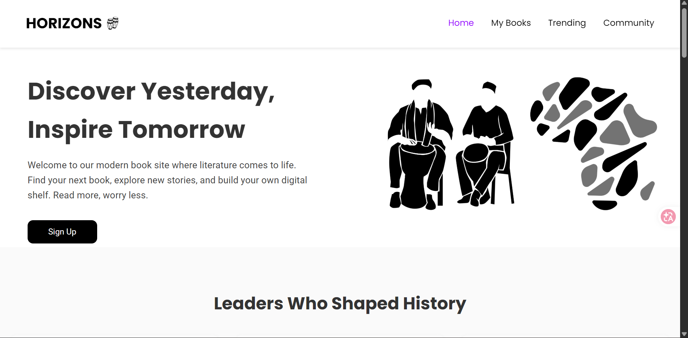

;p0# HorizonBooks (e-library-web)

HorizonBooks is an e-library web app focused on African history and literature — built to make it easy to discover, read about, and track books on African heritage, culture, and the leaders who shaped it.

Built as a project for the Swiss Intern Defence program (a 6-month skills/internship track), to demonstrate practical full-stack web development and secure backend design.

> No live demo — hosting expired and wasn't renewed. Clone and run it locally with XAMPP using the steps below.

## Features

- Browse books by category (African history, culture, leadership, etc.)
- Featured "Leaders Who Shaped History" section (Martin Luther King Jr., Nelson Mandela, Harriet Tubman, and more)
- User accounts with sign-up/login (Firebase Authentication)
- Personal dashboard — books read, currently reading, and favorites
- "My Library" to track saved books
- News & Articles and Recommendations sections

## Tech Stack

- **Frontend:** HTML5, CSS3, JavaScript
- **Backend:** PHP
- **Database:** MySQL
- **Auth:** Firebase Authentication (client-side) + PHP session handling (server-side)

## Screenshots

| Home | Leaders feature | Dashboard |
|---|---|---|
|  |  |  |


## Running it locally (XAMPP)

1. **Install [XAMPP](https://www.apachefriends.org/)** and start the **Apache** and **MySQL** modules from the XAMPP Control Panel.

2. **Clone the repo into your XAMPP `htdocs` folder:**
   ```bash
   cd C:\xampp\htdocs
   git clone https://github.com/charles-xv/e-library-web.git
   ```

3. **Create the database:**
   - Open [phpMyAdmin](http://localhost/phpmyadmin)
   - Create a new database named `horizonbooks`
   - Import the project's `.sql` file (in the repo, usually under `/database` or the project root) into that database

4. **Set the database connection** in `php/db.php` to point at your local MySQL instance:
   ```php
   
   (Default XAMPP MySQL has no root password — adjust the username/password if yours is different.)

5. **Add your Firebase config.** The app uses Firebase Authentication. Create `js/firebase-config.js` (gitignored — not committed) with your own Firebase project keys:
   ```js
   const firebaseConfig = {
     apiKey: "YOUR_API_KEY",
     authDomain: "YOUR_PROJECT.firebaseapp.com",
     projectId: "YOUR_PROJECT_ID",
     storageBucket: "YOUR_PROJECT.appspot.com",
     messagingSenderId: "YOUR_SENDER_ID",
     appId: "YOUR_APP_ID",
   };
   ```
   For server-side token verification, generate a Firebase **service account key** (Firebase Console → Project Settings → Service Accounts → Generate new private key) and place it where `login.php` expects it (keep this file out of git too).

6. **Visit the site:**
   ```
   http://localhost/e-library-web/html/index.html
   ```

## Project structure

```
e-library-web/
├── html/        # Static pages (index.html, etc.)
├── php/         # Backend logic (auth, db.php, dashboard, etc.)
├── js/          # Client-side JS, Firebase config
├── css/         # Stylesheets
└── vendor/      # Composer dependencies (ignored in git)
```

## Author

Charles Nnanna — [GitHub](https://github.com/charles-xv) · [LinkedIn](https://linkedin.com/in/charles-nnanna-666ba1252)
